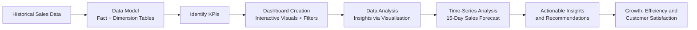
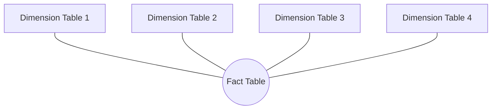
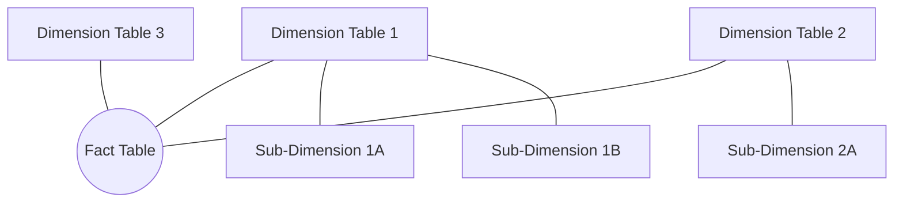
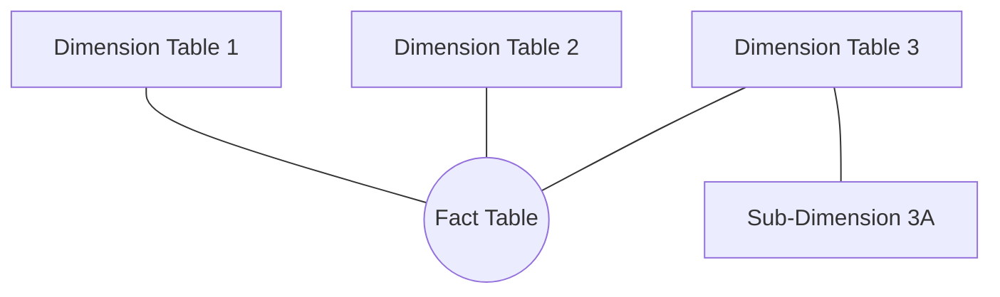
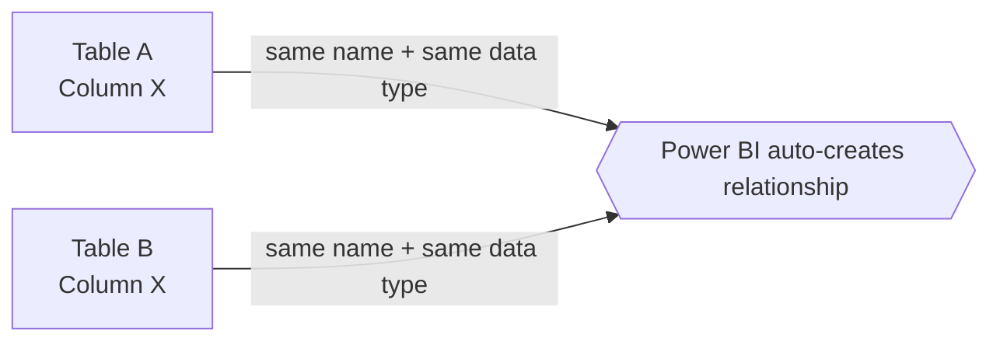
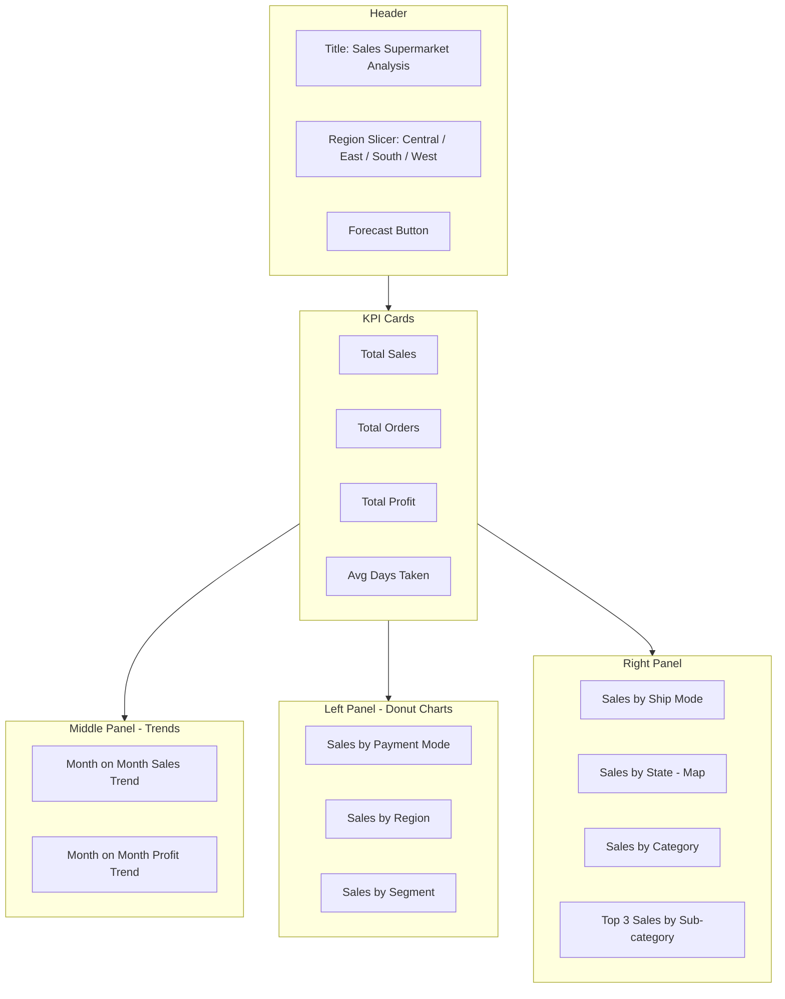
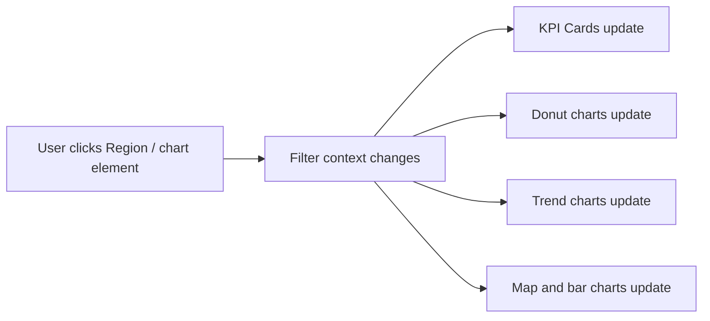

# Sales Supermarket Analysis – Power BI Dashboard

A Power BI project that applies **data analysis and time-series techniques** to supermarket sales data to deliver valuable insights and accurate sales forecasting.

---

## Table of Contents

1. [Objective](#objective)
2. [Project Description](#project-description)
3. [Project Workflow](#project-workflow)
4. [Data Model](#data-model)
5. [Dashboard Overview](#dashboard-overview)
6. [KPIs](#kpis)
7. [Dashboard Visuals](#dashboard-visuals)
8. [Filters and Interactivity](#filters-and-interactivity)
9. [Sales Forecasting](#sales-forecasting)
10. [Insights from the Dashboard](#insights-from-the-dashboard)
11. [Tools Used](#tools-used)

---

## Objective

To contribute to the success of the business by utilizing data analysis techniques, specifically focusing on **time-series analysis**, to provide valuable insight and accurate sales forecasting.

---

## Project Description

The objective is broken down into four categories:

| # | Category | What it covers |
|---|----------|----------------|
| 1 | **Dashboard Creation** | Identify the KPIs, design an intuitive and visually appealing dashboard, add interactive visuals and filtering capabilities so users can explore the data at various levels of granularity. |
| 2 | **Data Analysis** | Provide valuable insights to business entities regarding the effectiveness of their sales strategy through visualisation. |
| 3 | **Sales Forecasting** | Leverage historical data and apply time-series analysis to generate a sales forecast for the **next 15 days**. |
| 4 | **Actionable Insights and Recommendations** | The end goal is to provide insights and actionable information to drive strategic decisions and support the company's goals for growth, efficiency and customer satisfaction. |

---

## Project Workflow

---

## Data Model

### Star Schema
A common data modelling design used in Data Warehousing and Power BI to organise data into **facts** and **dimensions**, supporting efficient query and reporting.

- One **central fact table** (contains the metrics or facts of a business process)
- **Multiple dimension tables** connected to the fact table

### Snowflake Schema
- There is **still a central fact table**
- But the **dimension tables are split into multiple related tables**, which **reduces data redundancy**
- It is an **extension of the star schema**, and it **increases complexity** as well

### Mixed Schema
A **combination of both schemas** (Star + Snowflake) is called a Mixed Schema.

### Schema Comparison

| Schema | Central Fact Table | Dimension Tables | Redundancy | Complexity |
|--------|--------------------|------------------|------------|------------|
| Star | Yes | Directly connected, not split | Higher | Lower |
| Snowflake | Yes | Split into multiple related tables | Reduced | Increased |
| Mixed | Yes | Combination of both | – | – |

### Relationships in Power BI
When you have **multiple tables**, if the **column names are the same and their data types are the same**, Power BI **automatically creates a relationship** between them.

---

## Dashboard Overview

**Dashboard title:** *Sales Supermarket Analysis*

> Save the dashboard screenshot as `dashboard.png` in the same folder as this README so the image displays.

### Layout

---

## KPIs

| KPI | Value |
|-----|-------|
| **Total Sales** | 1.57M |
| **Total Orders** | 3003 |
| **Total Profit** | 175.26K |
| **Avg Days Taken** | 3.93 |

---

## Dashboard Visuals

| Visual | Chart Type | Purpose |
|--------|-----------|---------|
| Sales by Payment Mode | Donut chart | Sales split across Cards, COD and Online |
| Sales by Region | Donut chart | Sales split across West, East, South and Central |
| Sales by Segment | Donut chart | Sales split across Consumer, Corporate and Home Office |
| Month on Month Sales Trend | Area/line chart | Monthly sales comparison, **2019 vs 2020** |
| Month on Month Profit Trend | Area/line chart | Monthly profit comparison, **2019 vs 2020** |
| Sales by Ship Mode | Bar chart | Sales by Standard, Second, First Class and Same Day |
| Sales by State | Map | Geographic distribution of sales |
| Sales by Category | Bar chart | Sales by Office Supplies, Technology and Furniture |
| Top 3 Sales by Sub-category | Bar chart | Phones, Chairs and Binders |

### Values shown on the dashboard

**Sales by Payment Mode**

| Payment Mode | Sales | Share |
|--------------|-------|-------|
| COD | 667.42K | – |
| Online | 553.99K | 35.3% |
| Cards | 344.39K | 21.99% |

**Sales by Region**

| Region | Sales | Share |
|--------|-------|-------|
| West | 522.44K | 33.37% |
| East | 450.23K | – |
| South | 252.12K | 16.1% |
| Central | 341…K | – |

**Sales by Segment**

| Segment | Sales | Share |
|---------|-------|-------|
| Consumer | 753K | 48.0% |
| Corporate | 509.74K | 32.55% |
| Home Office | 303.06K | 19.3% |

**Top 3 Sales by Sub-category:** Phones, Chairs, Binders

---

## Filters and Interactivity

- **Region slicer** – Central, East, South, West buttons at the top filter every visual on the page.
- **Cross-filtering** – selecting a slice or bar in one visual filters the other visuals, so users can explore the data at various levels of granularity.
- **Forecast button** – navigates to the sales forecast view.

---

## Sales Forecasting

- Uses **historical sales data** and **time-series analysis**.
- Generates a **sales forecast for the next 15 days**.
- Accessible from the **Forecast** button on the dashboard.

---

## Insights from the Dashboard

Observations taken directly from the dashboard visuals:

- **Overall:** 3003 orders generated 1.57M in sales and 175.26K in profit, with an average of 3.93 days taken.
- **Region:** West contributes the largest share of sales (33.37%); South contributes the smallest visible share (16.1%).
- **Segment:** Consumer is the largest segment (48.0%), followed by Corporate (32.55%) and Home Office (19.3%).
- **Payment mode:** COD (667.42K) and Online (553.99K) are larger than Cards (344.39K).
- **Trend:** Monthly sales and profit are compared between 2019 and 2020, with sales rising toward the end of the year.
- **Sub-category:** Phones, Chairs and Binders are the top 3 sub-categories by sales.

These insights feed into the final goal: **actionable information that drives strategic decisions and supports the company's goals for growth, efficiency and customer satisfaction.**

---

## Tools Used

- **Power BI** – data modelling, DAX/visuals, dashboard and forecasting
- **Data Modelling** – Star / Snowflake / Mixed schema concepts
- **Time-Series Analysis** – sales forecasting

